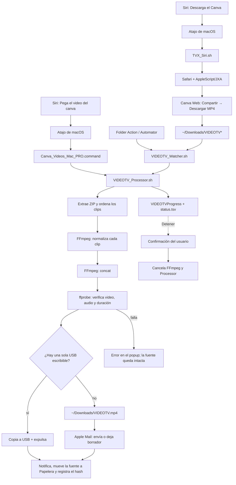

# Diagrama de flujo · VIDEOTV

También está disponible en:

- [`DIAGRAMA_FLUJO.png`](DIAGRAMA_FLUJO.png) — para pantalla o documentación.
- [`DIAGRAMA_FLUJO.pdf`](DIAGRAMA_FLUJO.pdf) — para imprimir o compartir.

## Flujo resumido

## Herramientas utilizadas

| Capa | Herramientas | Para qué |
|---|---|---|
| Activación | macOS, Siri, Atajos, Finder, Automator | Lanzar el flujo por voz o por Acción de carpeta. |
| Descarga | Safari, AppleScript, JavaScript for Automation | Abrir Canva y pulsar Compartir → Descargar. |
| Detección | Bash, `stat`, `shasum`, `unzip` | Esperar a que el archivo esté estable y validar que no sea un duplicado. |
| Procesamiento | Bash, `ditto`, `awk`, `sort` | Extraer, ordenar y preparar los clips. |
| Video | FFmpeg, ffprobe | Normalizar, unir y verificar el MP4 final. |
| Interfaz | Swift, AppKit, `NSVisualEffectView`, `NSAlert` | Popup de vidrio, progreso, ETA, confirmación y botón Detener. |
| Entrega | Apple Mail, AppleScript | Enviar el video o dejar un borrador para revisión. |
| Almacenamiento | `diskutil`, `plutil`, `cp`, `sync` | Detectar la USB, copiar y expulsarla de forma segura. |
| Avisos | `osascript` | Notificaciones del sistema. |

## Dónde queda cada cosa

| Ruta | Contenido |
|---|---|
| `~/Documents/Canva_Videos_Mac_PRO/` | Proyecto, comando de respaldo, este diagrama y el código fuente. |
| `~/Library/Application Support/VIDEOTV/` | Runtime instalado: scripts, UI, `status.tsv`, `processor.pid`, `mail_mode.txt` y logs. |
| `~/Downloads/VIDEOTV.mp4` | Video final cuando no hay una USB disponible. |
| `/Volumes/<nombre>/VIDEOTV.mp4` | Video final cuando hay una sola USB escribible. |

## Notas

- **Detener** cancela el procesamiento; no guarda el video final ni envía correo.
- Un **error de procesamiento** deja la fuente intacta y muestra el motivo en el popup.
- El **respaldo** `Canva_Videos_Mac_PRO.command` procesa una descarga que ya está en `~/Downloads`; es útil si la descarga automática falla o se pausa.
