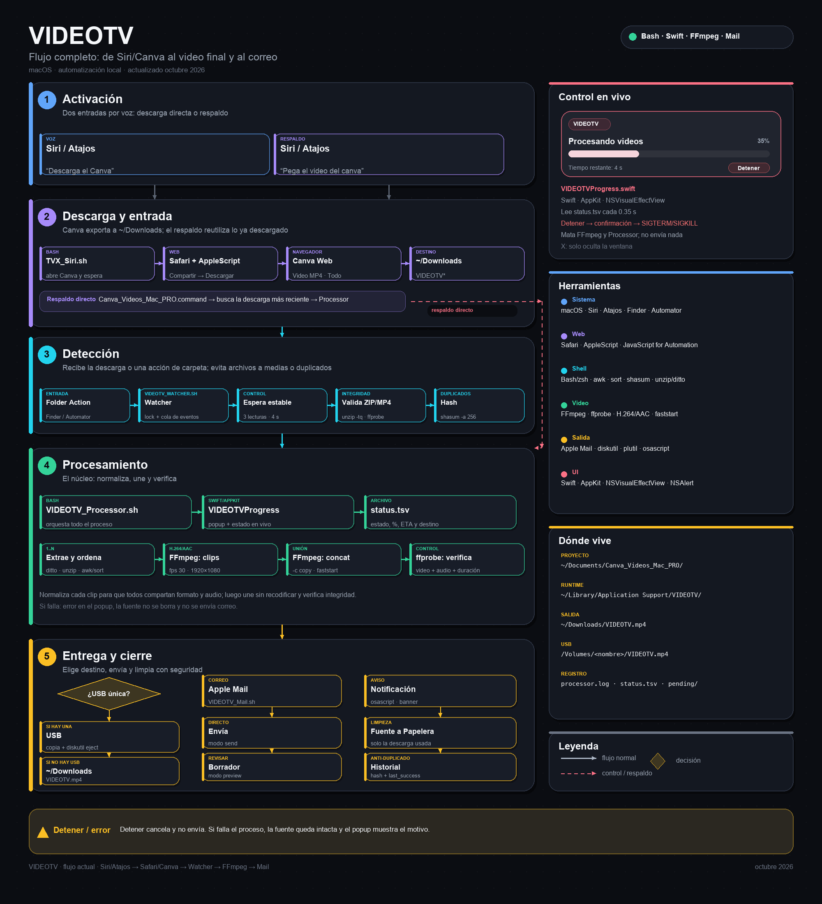

# Canva Video Automation for macOS

A small automation project that started because of a very specific problem: Canva was exporting a TV project as multiple video files, and joining them manually every time was slow and repetitive.

The first version was a single macOS script. Over time, the project evolved into **TVX**, an automated workflow that can detect a Canva export, process the videos, verify the result and prepare the final file with almost no manual work.

---

# Automatización de videos de Canva para macOS

Este proyecto nació por un problema bastante específico: Canva exportaba un proyecto para TV como varios archivos de video y unirlos manualmente cada vez era lento y repetitivo.

La primera versión fue un único script para macOS. Con el tiempo, el proyecto evolucionó hasta convertirse en **TVX**, un flujo automatizado capaz de detectar una exportación de Canva, procesar los videos, verificar el resultado y preparar el archivo final casi sin intervención manual.

---

## How it started

The original version is:

```text
Canva_Videos_Mac_PRO.command
```

It was designed as a manual workflow. After downloading the Canva export, the script could find the latest `VIDEOTV` export, organize the clips, join them and create the final video.

This version is still included in the repository because it represents the first working version of the project.

### Features

- Detects Canva exports as ZIP files or extracted folders
- Supports names such as `VIDEOTV`, `VIDEOTV (2)` and `VIDEO_TV`
- Sorts clips in natural numeric order
- Preserves the original audio from each video
- Normalizes videos to 1920x1080 at 30 FPS
- Joins all clips using FFmpeg
- Verifies the final video before considering the process complete
- Saves the result as `VIDEOTV.mp4`
- Can automatically use an external USB drive
- Falls back to Downloads when no USB is available
- Safely moves processed source files to Trash
- Can eject the USB automatically after finishing

---

## Cómo empezó

La versión original es:

```text
Canva_Videos_Mac_PRO.command
```

Fue diseñada como un flujo manual. Después de descargar la exportación de Canva, el script podía encontrar la exportación `VIDEOTV` más reciente, organizar los clips, unirlos y crear el video final.

Esta versión todavía se conserva en el repositorio porque representa la primera versión funcional del proyecto.

### Funciones

- Detecta exportaciones de Canva como archivos ZIP o carpetas descomprimidas
- Reconoce nombres como `VIDEOTV`, `VIDEOTV (2)` y `VIDEO_TV`
- Ordena los clips de forma numérica natural
- Conserva el audio original de cada video
- Normaliza los videos a 1920x1080 y 30 FPS
- Une todos los clips usando FFmpeg
- Verifica el video final antes de considerar terminado el proceso
- Guarda el resultado como `VIDEOTV.mp4`
- Puede utilizar automáticamente una memoria USB externa
- Si no hay USB, guarda el resultado en Descargas
- Mueve de forma segura los archivos procesados a la Papelera
- Puede expulsar automáticamente la USB al terminar

---

# TVX

TVX is the next stage of the project.

Instead of manually running the processing script, TVX uses macOS automation to react when a new Canva export arrives in the Downloads folder.

The workflow currently looks like this:

```text
Canva
  ↓
VIDEOTV.zip
  ↓
Automator
  ↓
VIDEOTV Watcher
  ↓
FFmpeg processing
  ↓
Native progress window
  ↓
Video verification
  ↓
VIDEOTV.mp4
  ↓
USB or Downloads
```

TVX also includes a native macOS progress window that shows the current stage of the process and the video being processed. If another export arrives while TVX is busy, it is queued and processed next. Locks left behind by a crash are detected and recovered automatically.

---

# TVX

TVX es la siguiente etapa del proyecto.

En lugar de ejecutar manualmente el script de procesamiento, TVX utiliza automatización de macOS para reaccionar cuando llega una nueva exportación de Canva a la carpeta Descargas.

Actualmente el flujo funciona así:

```text
Canva
  ↓
VIDEOTV.zip
  ↓
Automator
  ↓
VIDEOTV Watcher
  ↓
Procesamiento con FFmpeg
  ↓
Ventana nativa de progreso
  ↓
Verificación del video
  ↓
VIDEOTV.mp4
  ↓
USB o Descargas
```

TVX también incluye una ventana de progreso nativa de macOS que muestra la etapa actual del proceso y el video que se está procesando. Si llega otra exportación mientras TVX está ocupado, queda en cola y se procesa después. Los locks que deja un cierre inesperado se detectan y se recuperan automáticamente.

---

## Diagrama de flujo



- [`DIAGRAMA_FLUJO.png`](DIAGRAMA_FLUJO.png) — imagen para pantalla.
- [`DIAGRAMA_FLUJO.pdf`](DIAGRAMA_FLUJO.pdf) — versión para imprimir.
- [`DIAGRAMA_FLUJO.md`](DIAGRAMA_FLUJO.md) — explicación y diagrama Mermaid editable.

---

## Project structure

```text
Canva_Videos_Mac_PRO/
│
├── Canva_Videos_Mac_PRO.command
├── DIAGRAMA_FLUJO.png
├── DIAGRAMA_FLUJO.pdf
├── DIAGRAMA_FLUJO.md
│
├── tvx/
│   ├── automation/
│   │   └── TVX_Canva_Download.applescript
│   │
│   ├── automator/
│   │   └── AUTOMATOR_SCRIPT.txt
│   │
│   ├── mail/
│   │   ├── VIDEOTV_Mail.sh
│   │   └── VIDEOTV_Mail_corregido.applescript
│   │
│   ├── scripts/
│   │   ├── Instalar_TVX.command
│   │   ├── TVX_Siri.sh
│   │   └── Registrar_USB_VIDEOTV.command
│   │
│   ├── src/
│   │   ├── VIDEOTV_Processor.sh
│   │   └── VIDEOTV_Watcher.sh
│   │
│   └── ui/
│       └── VIDEOTVProgress.swift
│
├── .gitignore
└── README.md
```

---

## Estructura del proyecto

```text
Canva_Videos_Mac_PRO/
│
├── Canva_Videos_Mac_PRO.command
│
├── tvx/
│   ├── automation/
│   │   └── TVX_Canva_Download.applescript
│   │
│   ├── automator/
│   │   └── AUTOMATOR_SCRIPT.txt
│   │
│   ├── mail/
│   │   ├── VIDEOTV_Mail.sh
│   │   └── VIDEOTV_Mail_corregido.applescript
│   │
│   ├── scripts/
│   │   ├── Instalar_TVX.command
│   │   ├── TVX_Siri.sh
│   │   └── Registrar_USB_VIDEOTV.command
│   │
│   ├── src/
│   │   ├── VIDEOTV_Processor.sh
│   │   └── VIDEOTV_Watcher.sh
│   │
│   └── ui/
│       └── VIDEOTVProgress.swift
│
├── .gitignore
└── README.md
```

---

## Requirements

TVX currently runs on macOS and uses FFmpeg for video processing.

### Install Homebrew

If Homebrew is not installed:

```bash
/bin/bash -c "$(curl -fsSL https://raw.githubusercontent.com/Homebrew/install/HEAD/install.sh)"
```

On Apple Silicon Macs:

```bash
eval "$(/opt/homebrew/bin/brew shellenv)"
```

### Install FFmpeg

```bash
brew install ffmpeg
```

### Xcode Command Line Tools

TVX compiles its progress window with Swift. Install the tools with:

```bash
xcode-select --install
```

### USB allowlist

To restrict which USB drives can receive the video, edit:

```text
~/Library/Application Support/VIDEOTV/usb_allowlist.txt
```

Put one volume UUID per line. An empty file allows any writable USB drive.

---

## Requisitos

TVX actualmente funciona en macOS y utiliza FFmpeg para procesar los videos.

### Instalar Homebrew

Si Homebrew todavía no está instalado:

```bash
/bin/bash -c "$(curl -fsSL https://raw.githubusercontent.com/Homebrew/install/HEAD/install.sh)"
```

En Macs con Apple Silicon:

```bash
eval "$(/opt/homebrew/bin/brew shellenv)"
```

### Instalar FFmpeg

```bash
brew install ffmpeg
```

### Xcode Command Line Tools / Herramientas de línea de comandos

TVX compila su ventana de progreso con Swift. Instálalas con:

```bash
xcode-select --install
```

### Lista de USB permitidas

Para restringir qué USB pueden recibir el video, edita:

```text
~/Library/Application Support/VIDEOTV/usb_allowlist.txt
```

Pon un UUID de volumen por línea. Un archivo vacío permite cualquier USB escribible.

---

## Installing TVX

From the repository, run:

```bash
chmod +x tvx/scripts/Instalar_TVX.command
./tvx/scripts/Instalar_TVX.command
```

The installer copies the required files into:

```text
~/Library/Application Support/VIDEOTV/
```

It also prepares the Automator script so it can be added to a macOS Folder Action watching the Downloads folder.

---

## Mail integration (optional)

Mail is **disabled by default** (`mail_mode.txt` contains `off`). The installer only creates this file when it does not exist, so an existing mode is preserved.

- `off`: TVX never opens Mail.
- `preview`: TVX prepares a draft in Apple Mail but does not send it.
- `send`: TVX sends the video to the configured recipient.

With `send`, TVX tells Mail to send the draft automatically: it is the same
action as pressing Mail's **Enviar** button, but done through Mail's scripting
interface (more reliable than a simulated UI click). The current installation
uses `send`, so you no longer need to press **Enviar**. Once Mail accepts the
message, the popup closes; TVX does not wait for a copy to appear in **Sent**,
because iCloud can take a long time (or never expose it) even when the email was
delivered. If you prefer to review the draft first, switch to `preview`; TVX
never sends in `preview` mode. If the draft cannot be prepared, the video is
still saved and TVX shows a normal "saved" status instead of an error.

Gmail cannot send a 332 MB attachment (limit ~25 MB). To stop Gmail from trying
to upload a huge draft, set the account's **Drafts** mailbox to **On My Mac**
(Mail > Settings > Accounts > account > Mailbox Behaviors > Drafts). For large
videos, send a cloud link instead of the attachment.

The sender and recipient are defined in `tvx/mail/VIDEOTV_Mail_corregido.applescript`
(installed as `VIDEOTV_Mail.applescript`). Replace the placeholders
`you@example.com` and `recipient@example.com` with your real addresses before
using `send`.

Change the attachment limit in:

```text
~/Library/Application Support/VIDEOTV/mail_max_mb.txt
```

Change the mode in:

```text
~/Library/Application Support/VIDEOTV/mail_mode.txt
```

To test the send without changing the real recipient, set `TVX_MAIL_TO`:

```bash
TVX_MAIL_TO="test@example.com" \
  "$HOME/Library/Application Support/VIDEOTV/VIDEOTV_Mail.sh" /ruta/video.mp4
```

---

## Instalar TVX

Desde el repositorio ejecuta:

```bash
chmod +x tvx/scripts/Instalar_TVX.command
./tvx/scripts/Instalar_TVX.command
```

El instalador copia los archivos necesarios en:

```text
~/Library/Application Support/VIDEOTV/
```

También prepara el script de Automator para poder utilizarlo dentro de una Acción de carpeta de macOS que vigile Descargas.

---

## Integración con Mail (opcional)

Mail está **desactivado por defecto** (`mail_mode.txt` contiene `off`). El instalador solo crea este archivo si no existe, así que un modo ya configurado se conserva.

- `off`: TVX no abre Mail.
- `preview`: TVX prepara un borrador en Apple Mail, pero no lo envía.
- `send`: TVX envía el video al destinatario configurado.

Con `send`, TVX le pide a Mail que envíe el borrador automáticamente: es la
misma acción que pulsar **Enviar** en Mail, pero por la interfaz de scripting de
Mail (más fiable que simular un clic). La instalación actual usa `send`, así que
ya no tienes que pulsar **Enviar**. En cuanto Mail acepta el mensaje, el popup se
cierra; TVX no espera a que aparezca una copia en **Enviados**, porque iCloud
puede tardar mucho (o no mostrarla nunca) aunque el correo ya se haya entregado.
Si prefieres revisar el borrador antes, cambia a `preview`; en `preview`, TVX
nunca envía. Si el borrador no se puede preparar, el video sigue guardado y TVX
muestra un estado normal de "guardado", no un error.

Gmail no puede enviar un adjunto de 332 MB (límite ~25 MB). Para evitar que Gmail
intente subir un borrador enorme, configura el buzón **Borradores** de la cuenta
como **En mi Mac** (Mail > Ajustes > Cuentas > cuenta > Comportamiento de buzones >
Borradores). Para videos grandes, envía un enlace en la nube en vez del adjunto.

El remitente y el destinatario se definen en `tvx/mail/VIDEOTV_Mail_corregido.applescript`
(se instala como `VIDEOTV_Mail.applescript`). Antes de usar `send`, reemplaza los
placeholders `you@example.com` y `recipient@example.com` por tus direcciones reales.

Cambia el límite de adjunto en:

```text
~/Library/Application Support/VIDEOTV/mail_max_mb.txt
```

Cambia el modo en:

```text
~/Library/Application Support/VIDEOTV/mail_mode.txt
```

Para probar el envío sin cambiar el destinatario real, usa `TVX_MAIL_TO`:

```bash
TVX_MAIL_TO="test@example.com" \
  "$HOME/Library/Application Support/VIDEOTV/VIDEOTV_Mail.sh" /ruta/video.mp4
```

---

## Siri / Shortcuts

TVX can be started from Siri with a macOS Shortcut.

1. Open **Shortcuts** and create a new shortcut.
2. Add the action **Run Shell Script**.
3. Paste:

```bash
"$HOME/Library/Application Support/VIDEOTV/TVX_Siri.sh"
```

4. Name the shortcut **Descarga el Canva**.
5. Say: **“Oye Siri, descarga el Canva”**.

If Siri doesn't run it, open the shortcut and use **Add to Siri** to record the
phrase. In Shortcuts settings, enable **Allow Running Scripts** if prompted.

What it does:

- Opens or activates Canva web in Safari.
- Waits for a new `VIDEOTV*.zip`, folder, or `VIDEOTV*.mp4` in Downloads.
- Starts TVX with the normal join flow, or accepts a single MP4 as-is.

Slide durations are checked manually in Canva; TVX no longer blocks on 10 s.
Export the design as **MP4, pages as separate files** if you want TVX to join
the pages; a single MP4 is also accepted.

TVX now tries to press **Download** and fill the export dialog for you. This uses
macOS Accessibility, so the first time you must allow **Shortcuts** (or Terminal)
in System Settings > Privacy & Security > Accessibility. If TVX can't find a
button (Canva changed, no permission, unknown dialog), it falls back to waiting
for you to press Download; it never blocks the rest of the flow.

The auto-download targets **Canva web in Safari**. Keep the Canva design tab
open and in front; the script activates that window. If it can't find a button,
it falls back to waiting for you to press Download. To disable auto-click, run
the shortcut with `TVX_CANVA_AUTOCLICK=0`. To inspect Canva's real button names,
run:

```bash
"$HOME/Library/Application Support/VIDEOTV/TVX_Siri.sh" --inspect
```

Optional: put the Canva design URL in
`~/Library/Application Support/VIDEOTV/canva_url.txt` so Siri opens that design.

---

## Current status

TVX is still evolving.

The current version already handles the full video-processing workflow, including automatic detection, progress feedback, verification and USB delivery.

Mail can draft (`preview`) or send automatically (`send`); the current installation uses `send`. The Siri / Shortcuts flow is implemented and tested end-to-end.

---

## Siri / Atajos

TVX se puede iniciar desde Siri con un atajo de macOS.

1. Abre **Atajos** y crea un atajo nuevo.
2. Añade la acción **Ejecutar script de shell**.
3. Pega:

```bash
"$HOME/Library/Application Support/VIDEOTV/TVX_Siri.sh"
```

4. Nombra el atajo **Descarga el Canva**.
5. Di: **“Oye Siri, descarga el Canva”**.

Si Siri no lo ejecuta, abre el atajo y usa **Añadir a Siri** para grabar la
frase. En los ajustes de Atajos, activa **Permitir ejecutar scripts** si te lo
pide.

Qué hace:

- Abre o activa Canva web en Safari.
- Espera un nuevo `VIDEOTV*.zip`, carpeta o `VIDEOTV*.mp4` en Descargas.
- Inicia TVX con el flujo normal de unión, o acepta un MP4 único tal cual.

La duración de cada diapositiva la revisas tú manualmente en Canva; TVX ya no
bloquea por los 10 s. Exporta como **MP4, páginas como archivos separados** si
quieres que TVX una las páginas; un MP4 único también se acepta.

TVX ahora intenta pulsar **Descargar** y completar el diálogo de exportación por
ti. Usa Accesibilidad de macOS, así que la primera vez debes permitir **Atajos**
(o Terminal) en Ajustes > Privacidad y seguridad > Accesibilidad. Si no encuentra
un botón (Canva cambió, no hay permiso, diálogo desconocido), vuelve al modo
manual y espera a que pulses Descargar; no bloquea el resto del flujo.

La descarga automática apunta a **Canva web en Safari**. Deja la pestaña del
diseño abierta y al frente; el script activa esa ventana. Si no encuentra un
botón, vuelve al modo manual y espera a que pulses Descargar. Para desactivar el
auto-click, ejecuta el atajo con `TVX_CANVA_AUTOCLICK=0`. Para ver los nombres
reales de los botones de Canva, ejecuta:

```bash
"$HOME/Library/Application Support/VIDEOTV/TVX_Siri.sh" --inspect
```

Opcional: guarda la URL del diseño de Canva en
`~/Library/Application Support/VIDEOTV/canva_url.txt` para que Siri abra ese
diseño.

---

## Estado actual

TVX todavía sigue evolucionando.

La versión actual ya se encarga de todo el flujo de procesamiento de video, incluyendo detección automática, progreso visual, verificación y entrega mediante USB.

El correo en modo borrador y el flujo con Siri / Atajos ya están implementados. El envío automático sigue siendo opcional.

---

## Popup de vidrio y botón Detener

El progreso ahora usa un estilo **glass morphism** (vidrio oscuro, bordes luminosos y píldoras) y tiene un botón **Detener**. Al pulsarlo pide confirmación; si aceptas, cancela FFmpeg y el procesador, no guarda el video y no envía nada.

## Respaldo manual: “pega el video del canva”

Si la descarga automática falla o se pausa y quieres ajustar el video ya descargado:

1. Deja el archivo, la carpeta o el ZIP de Canva en **Descargas**.
2. Ejecuta:

```bash
"/Users/davids3/Documents/Canva_Videos_Mac_PRO/Canva_Videos_Mac_PRO.command"
```

El comando busca la descarga más reciente que contenga `VIDEOTV` o `VIDEO_TV`, abre el mismo popup (con Detener), procesa, guarda y, si corresponde, envía el correo.

También quedó creado el atajo **Pega el video del canva** en Atajos. Ese atajo apunta a la copia instalada:

```bash
"$HOME/Library/Application Support/VIDEOTV/Canva_Videos_Mac_PRO.command"
```

Se usa la copia de `Application Support` porque Shortcuts no puede ejecutar archivos dentro de `Documents` (por eso aparecía “Operation not permitted”). El comando de `Documents` sigue sirviendo para doble clic desde Finder.

En macOS no existe el botón **Añadir a Siri** que aparece en iPhone. Siri ejecuta los atajos por su nombre: di **“Oye Siri, pega el video del canva”**. Si Siri sigue pidiendo el prefijo, la alternativa es **“Oye Siri, ejecuta el atajo Pega el video del canva”**.
